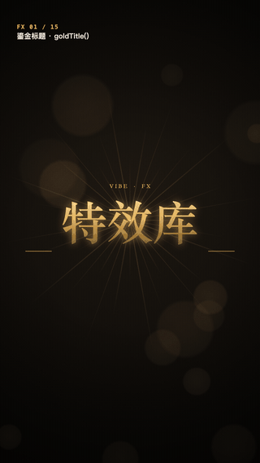
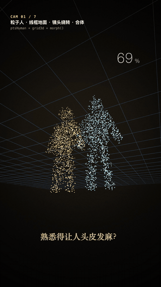
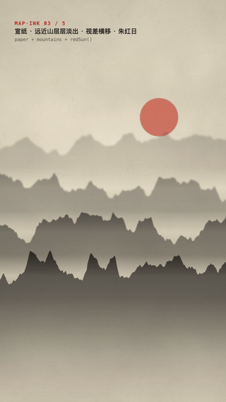
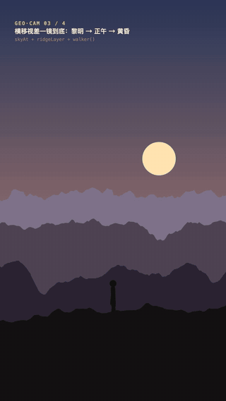
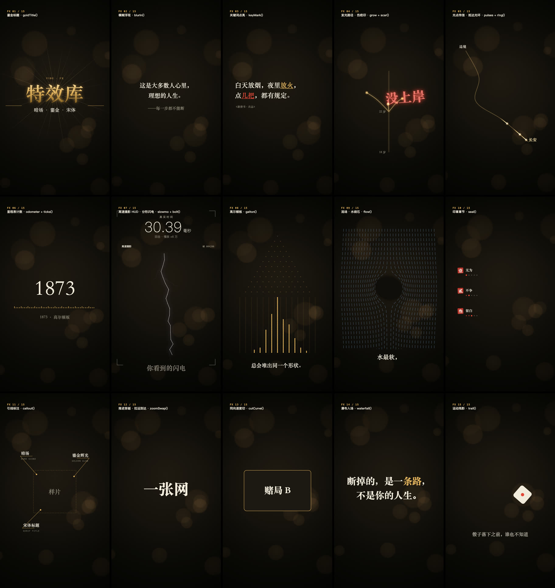

# vibe-fx

[中文](README.md) | **English**

A Canvas effects library for AI agents that write code to make motion-graphics videos: 17 effects, camera moves and 3D, shaded-relief terrain, Chinese ink painting, and real-world maps. Plain JavaScript, zero dependencies, vertical 1080×1920.

The techniques come from two sources: frame-by-frame breakdowns of top-performing videos in Douyin's "Vibe Knowledge" series, and 9 popular motion-graphics skill repos on GitHub. **Techniques only, no assets**: no copy, fonts, music or footage was copied, and all code was written from scratch.

## Preview

<table>
<tr>
<td></td>
<td></td>
<td></td>
<td></td>
</tr>
<tr>
<td align="center">Effects: title · scar · lightning</td>
<td align="center">Camera & 3D: particles · warp</td>
<td align="center">Ink: mountains · calligraphy</td>
<td align="center">Camera moves: parallax · 3D corridor</td>
</tr>
</table>

Every effect in fx.js (15 demo segments covering all 17 effects):



| Demo | Content |
|---|---|
| `demo.html` | fx.js effects, 15 segments one by one (64 s) |
| `demo-cam.html` | Camera & 3D: follow cam, picture-in-picture push/pull, split screen, color grading, point-cloud morphing, warp jump (41 s) |
| `demo-map-ink.html` | Shaded-relief terrain map + ink painting (26.5 s) |
| `demo-geo-cam.html` | Real map, one-take parallax pan, 3D archive corridor push-in (28 s) |

The on-screen text in the demos is Chinese; the library itself works with any text.

## Quick start

Download the repo and open any `demo*.html` in Chrome. The bar at the bottom controls playback: Space to play/pause, ← → to jump 2 s, drag to seek.

In your own page:

```html
<canvas id="c" width="1080" height="1920"></canvas>
<script src="fx.js"></script>
<script>
const X = document.getElementById('c').getContext('2d');
function draw(t) {                       // t = current time in seconds
  FX.bg(X, t);                           // dark background with warm gold glow
  FX.goldTitle(X, t, 0.5, 'Resilience', 540, 900, { sub: 'Life is not a single line' });
  FX.scar(X, t, 2.5, 'FAILED', 540, 1300);
}
</script>
```

Every function is a pure function of `t`, so frames can be rendered in any order. That makes it easy to screenshot frame by frame with Playwright / Puppeteer and assemble the video with ffmpeg. All randomness is seeded: the same `t` always draws the same frame.

**Load order is fixed**; load only what you need: `fx.js` → `fx-cam.js` → `fx-map.js` → `fx-ink.js`. For real maps, add `geo/world_countries_110m.js` (and optionally `geo/china_provinces.js`), then `fx-geo.js` last.

**Conventions**: `X` = canvas 2D context; `t` = current time in seconds; `t0` = the second an effect starts, usually aligned to the moment a word is spoken.

## Files

| File | Purpose |
|---|---|
| `fx.js` | Core library, global object `FX`: 17 effects + easing / spring helpers |
| `fx-cam.js` | Camera & 3D: 2D camera, follow cam, picture-in-picture push/pull, split screen ↔ single panel, color-grading storytelling, perspective projection, wireframe ground, point-cloud sampling and morphing, warp jump, white flash, parallax pan, 3D boxes and corridor. Requires fx.js |
| `fx-map.js` | Shaded-relief terrain: procedural mountains with lighting (sepia / night / paper palettes, optional contour lines), place markers + rings. Requires fx.js |
| `fx-ink.js` | Ink painting: rice paper, layered fading mountains, brush strokes, ink drops, calligraphy being written, red sun. Requires fx.js + fx-map.js |
| `fx-geo.js` | Real geographic boundaries: Albers / Natural Earth projections, outline reveal, province / country highlight, lon-lat to screen coordinates |
| `geo/world_countries_110m.js` | World country borders, Natural Earth 1:110m, 177 countries, public domain |
| `geo/convert-china.mjs` | Converts DataV China province data into `geo/china_provinces.js` (data not included, see below) |
| `play.js` | Playback bar for the demo pages |
| `demo*.html` | Four demo pages |
| `preview/` | Preview GIFs and the contact sheet used in this README |

## Effects (fx.js)

| # | Function | What it is | When to use |
|---|---|---|---|
| 1 | `bg(X,t)` | Radial dark background + warm bokeh + film grain + vignette | Base for the dark-and-gold style; other styles can use just `grainAndVignette` for texture |
| 2 | `blurIn(X,t,t0,s,x,y)` | Text goes from blurred to sharp, dark to bright, moving ≤1% | Default entrance for subtitles and narration, instead of popping in |
| 3 | `keyMark(X,t,t0,line,key,x,y)` | A keyword in a line turns gold or red, with an underline drawn in | The frame the keyword is spoken |
| 4 | `grow(X,t,t0,dur,pts)` + `path/pointAt/comet` | Glowing curve grows with a comet head; branches = call it again, staggered by 0.18 s | A metaphor line running through the video, paths, timelines |
| 5 | `pulses(...)` + `ring(...)` | Light dots flow along a path, with an elliptical ring on arrival | Handoffs, data flow, A to B |
| 6 | `scar(X,t,t0,s,x,y)` | Big glowing red text slams down + elliptical shockwave | Setbacks, twists, verdicts; once per segment |
| 7 | `odometer(...)` + `ticks(...)` | Digits roll one place at a time, with a lighting-up ruler | Years advancing, how much something grew |
| 8 | `slowmo(X,t,{ms,rate})` | Viewfinder + "real time xx.xx ms" + slow-motion factor + REC + frame counter | Stretching one instant |
| 9 | `bolt(X,t,t0,{...})` | Stepped leader creeps down step by step; on ground contact the main channel flashes white | Lightning, sudden events, inspiration, fission |
| 10 | `galton(X,t,t0,{...})` | Galton board: balls drop one by one and pile into a bell curve | Probability, large numbers, regression to the mean |
| 11 | `flow(X,t,t0,{cx,cy,R})` | Streamlines around a cylinder, dashes flowing downstream | Going around obstacles, going with the flow |
| 12 | `goldTitle(X,t,t0,s,x,y)` | Light rays + gold-gradient serif text appearing letter by letter + small Latin caption + side rules | Opening titles, closing lines |
| 13 | `seal(X,t,t0,{num,title,i,n})` | Red square seal stamps down + chapter name + ●○○○○ progress | Chapters like "five words", "three pitfalls" |
| 14 | `callout(X,t,t0,{ax,ay,bx,by,cn,en})` | Anchor → leader line → label + small secondary label | Labeling things on screen |
| 15 | `zoomSwap(...)` / `cutCurve(...)` | Push-through zoom, pull-back arrival, same-direction speed cut | Word swaps, section transitions, "arrival" conclusions |
| 16 | `waterfall(X,t,t0,s,x,y,{heavy})` | Characters fling up from below one by one with shrinking gaps; heavy ones travel further in gold | Key lines, chapter headlines |
| 17 | `trail(X,t,fn)` | Draws the same function at several past times = motion trail | Dice, flying objects |

Helpers: `FX.E` (p3o / p4o / p3i / p4i / expo / io easing), `FX.spring(t,w,z)`, `FX.nudge(x)` (slow-fast-slow move), `FX.rng(seed)`, `FX.mix(a,b,k)`, `FX.C` (palette).

## Camera & 3D (fx-cam.js)

| Function | Purpose |
|---|---|
| `applyCam(X,{x,y,zoom,rot})` | Points the camera at world coordinate (x,y); everything drawn after is in camera space |
| `camKeys(t,[[t,{x,y,zoom,rot},ease],…])` | Keyframed camera, eased between keys |
| `camFollow(path,d,{zoom,lead,lag})` | Follows a subject moving along a path |
| `nest(X,k,rect,drawOuter,drawInner)` | Picture-in-picture push in (k 0→1) / pull out (k 1→0). rect can be a character, a screen, a page |
| `panels(X,k,[fn…],{focus})` | Split screen ↔ single panel |
| `desat(X,k)` / `tint(X,color,k,mode)` / `colorSweep(X,k,gray,color)` | Desaturate / overall tint (day-night) / diagonal light sweep from gray to color |
| `project(p,cam3)` / `grid3d(X,cam3)` | Perspective projection / wireframe ground. cam3 = {yaw,pitch,dist,fov,tx,ty,tz} |
| `ptsText` `ptsHuman` `ptsSphere` `ptsGalaxy` `ptsDust` `ptsFromDraw` `shift` | Point-cloud sampling: text, human figure, sphere, galaxy, ground dust, any silhouette |
| `morph(A,B,k)` / `cloud(X,pts,cam3,{color})` | Staggered arc morph between point clouds / draws them with depth size and brightness |
| `warp(X,t,t0,dur)` / `flash(X,t,tc)` | Warp jump / one-frame white overexposure |
| `skyAt(X,camX,[[camX,top,bottom],…])` | Sky color follows camera position (dawn → noon → dusk) |
| `ridgeLayer(X,camX,{depth,base,amp,color,seed})` | An endlessly scrolling mountain silhouette layer; depth 0 = farthest, 1 = nearest. **Requires fx-map.js** |
| `walker(X,x,y,t,{h})` | Walking silhouette figure |
| `box3d(X,cam3,[x0,y0,z0],[x1,y1,z1],{color,fog,label})` | A 3D box (back-face culling, per-face lighting, fades into fog) |
| `corridor(X,cam3,{len})` | Archive corridor: two rows of cabinets, floor and ceiling, ceiling lights, end wall and desk |

Pattern: a parallax pan is just one number, `camX`, moving with time; the corridor uses `camKeys` to keyframe `tz` (forward), `ty` (rise) and `pitch` (look down).

Pitfalls: after a white flash, the next scene must have content **immediately**, or you get black frames; clamp the max radius of points close to the camera, or they become big blobs.

## Terrain & ink (fx-map.js / fx-ink.js)

| Function | Purpose |
|---|---|
| `terrainCanvas({w,h,seed,scale,ridge,relief,palette,water,contour})` / `terrain(X,opts)` | Generates and draws a full shaded-relief terrain. palette: `sepia`, `night`, `paper`; a number for `contour` draws contour lines. Pan and zoom over it with `applyCam` + `camKeys` |
| `place(X,t,t0,x,y,name,{ring})` | Place marker: glowing dot + name, optional arrival ring |
| `paper(X)` | Rice-paper background (fibers, tone variation, darkened corners) |
| `mountains(X,t,{n,top,gap,drift})` | n mountain layers, farther = lighter and blurrier, mist between layers; `drift` sets parallax speed |
| `brush(X,t,t0,dur,pts,{width,dry})` | Brush stroke written along a path; higher `dry` = more dry-brush gaps |
| `inkDrop(X,t,t0,x,y,{r})` | Ink drop spreading + splatter |
| `brushChar(X,t,t0,'道',x,y,{size})` | Large calligraphy character with ink texture, written top-left to bottom-right, ending with a splash |
| `redSun(X,t,t0,x,y,r)` | Red sun |

## Real maps (fx-geo.js)

| Function | Purpose |
|---|---|
| `albers({lon0,lat1,lat2})` / `naturalEarth({lon0})` | Projections: Albers for China (default 105°E, 25°/47°N), Natural Earth for the world |
| `geoMap(X,t,t0,{data:'china'/'world',proj,box,highlight,only,reveal})` | Fits the whole dataset into box; outlines reveal outward from the center; `highlight: {'美国': [color, startSecond]}` |
| `geoXY(data,proj,box,lon,lat)` | Lon-lat → screen coordinates, for placing `place`, `grow`, `pulses` |

Country and province names in the data are in Chinese (for example `'美国'` = United States, `'英国'` = United Kingdom); each country also has an `iso` code.

**China province data is not included.** To generate it:

1. Download `https://geo.datav.aliyun.com/areas_v3/bound/100000_full.json` (Alibaba Cloud DataV.GeoAtlas) and save it as `geo/china_provinces.json`
2. Run `node geo/convert-china.mjs` to produce `geo/china_provinces.js`

**Compliance note**: content published in mainland China that shows a map of China must show the complete national borders, including Taiwan and the South China Sea islands; zooming in on a region is fine. China's borders in `data:'world'` may not meet these requirements, so use it only for scenes that don't involve China. DataV data has no official map approval number; for strict requirements, use the standard map service of China's Ministry of Natural Resources.

Pitfall: keep the world map's central longitude at 0 and frame the view by moving the box; lines crossing the map seam are broken automatically.

## Motion rules (break them and it looks like a slideshow)

1. **The main visual lands on the same frame the concept is spoken**, within +0.5 s
2. **Sawtooth density**: add one small element every 1–2 s, about 3 visual objects on screen; clear the whole group at the end of a section, with 1–1.5 s of empty screen
3. **Still once in place**: no idle breathing or floating. Liveliness comes from the next addition
4. **Only slow down when the process is the message**: number rolls about 1 s, curve growth about 0.55–3 s; big text enters in about 0.33 s and exits faster than it entered
5. **Transitions keep speed continuous**: cut mid-motion, same direction and speed on both sides, no cross-dissolves. Use only 2–3 transition types per video
6. **One big move per section**: heavy hits like `scar` or screen shake, at most 2 per video
7. **Leave 0.3–0.75 s of stillness between action and result**, so the conclusion lands
8. **Don't pre-draw scaffolding**: no lines, frames or placeholders for things not yet mentioned
9. **Facts are hard constraints**: only use numbers and studies with a source; mark illustrative content as illustrative

## Fonts

Defaults to the macOS system fonts Songti SC (serif), PingFang SC (sans) and STKaiti (calligraphy), falling back to Noto Serif SC and others. On Windows / Linux, install Noto Serif SC / Noto Sans SC for the closest look.

## Credits

Motion techniques were inspired by these open-source projects (ideas only, code written from scratch):
heygen-com/hyperframes, jincheng2026/jc-remotion-skills, charlie947/motion-graphics-skills, Barty-Bart/motion-graphics, tuzhechen2005/opus-video-skills, bangtutorial/bang-motion, nateherkai/herk-edit-kit, iart-ai/motion-skills, latent-spaces/brag.

Geographic data: [Natural Earth](https://www.naturalearthdata.com/) (public domain); China province borders are downloaded by the user from Alibaba Cloud DataV.GeoAtlas.

## Author

Bowen · 20 years in product management, solving 100 real problems hands-on with AI

Douyin (Chinese TikTok): [Bowen的AI实战笔记](https://www.douyin.com/user/MS4wLjABAAAAsVy4x0FpjE8j4epQQZtZkg2OOU2Vb3G5UweYp5ZZwd0) (ID 1083328779)

Other open-source projects (Chinese docs):
- [meeting-minutes](https://github.com/ttgg20200101-claw/meeting-minutes): say "start meeting" to record, "end" to get meeting minutes with fact-checking
- [workbuddy-bridge](https://github.com/ttgg20200101-claw/workbuddy-bridge): AI as supervisor, WorkBuddy as worker

## License

MIT
